  <picture><source media="(prefers-color-scheme: light)" srcset="header/header-light.png"></picture>

###  OBSIDIAN

  <a href="https://github.com/itsNikolay/obsidian-mermaid-flow-enhancer"><picture><source media="(prefers-color-scheme: light)" srcset="https://raw.githubusercontent.com/itsNikolay/itsNikolay/main/cards/obsidian-mermaid-flow-enhancer/card-light.png"></picture></a>
  &nbsp;&nbsp;
  <a href="https://github.com/itsNikolay/obsidian-hovered-table-of-content"><picture><source media="(prefers-color-scheme: light)" srcset="https://raw.githubusercontent.com/itsNikolay/itsNikolay/main/cards/obsidian-hovered-table-of-content/card-light.png"></picture></a>

###  CHROME

  <a href="https://chromewebstore.google.com/detail/Transcript%20YouTube/obigemjopcmecfaacinededdfdcinikk"><picture><source media="(prefers-color-scheme: light)" srcset="https://raw.githubusercontent.com/itsNikolay/itsNikolay/main/cards/transcript-youtube/card-light.png"></picture></a>

