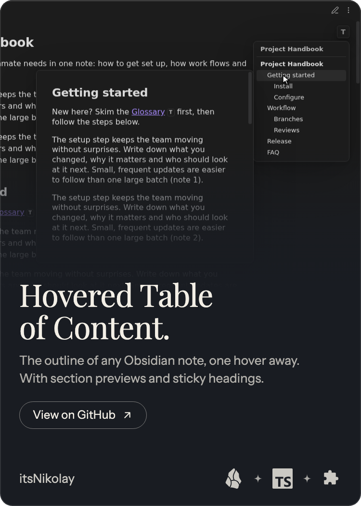

Ruby on Rails developer building tools that make everyday work a little easier.

<a href="https://github.com/itsNikolay?tab=repositories">All repositories</a> · <a href="https://github.com/itsNikolay/nponomarev.com">Development blog</a> · <a href="https://github.com/itsNikolay?tab=stars">Things I find useful</a>

## Featured projects

Small tools for a smoother Obsidian workflow. Explore a project below.

  
  

## More tools

### [Chrome Window Splitter ↗](https://github.com/itsNikolay/chrome-extension-splitter)

Arrange Chrome windows side by side in convenient positions on your desktop.

`Chrome extension` `TypeScript` `Productivity`

---

Explore the <a href="https://github.com/itsNikolay?tab=repositories">full project collection</a>.

