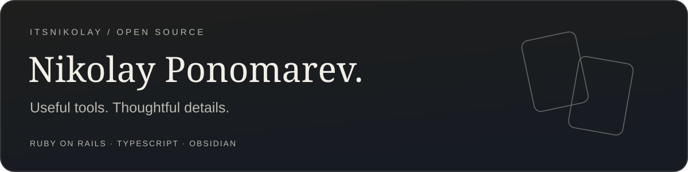

Ruby on Rails developer building tools that make everyday work a little easier.

<a href="https://github.com/itsNikolay?tab=repositories">All repositories</a> · <a href="https://github.com/itsNikolay/nponomarev.com">Development blog</a> · <a href="https://github.com/itsNikolay?tab=stars">Things I find useful</a>

## Featured projects

### Mermaid Flow Enhancer

**Clearer diagrams, right inside Obsidian.**

An Obsidian plugin for compact Mermaid flowcharts: aligned branches, cleaner connectors, light and dark themes, and smooth ancestor-path highlighting when you hover over a node.

[View source →](https://github.com/itsNikolay/obsidian-mermaid-flow-enhancer) · [Watch the demo →](https://github.com/itsNikolay/obsidian-mermaid-flow-enhancer#preview) · [Latest release →](https://github.com/itsNikolay/obsidian-mermaid-flow-enhancer/releases/latest)

`Obsidian` `Mermaid` `TypeScript` `Flowcharts` `MIT`

<!-- PROJECTS: Add new project sections above this marker. Use a title, benefit, brief description, optional image, and source/demo links. Keep older projects below the featured project. -->

---

### Chrome Window Splitter

Arrange Chrome windows side by side in convenient positions on your desktop.

[View source →](https://github.com/itsNikolay/chrome-extension-splitter)

`Chrome extension` `TypeScript` `Productivity`

---

Explore the <a href="https://github.com/itsNikolay?tab=repositories">full project collection</a>.

