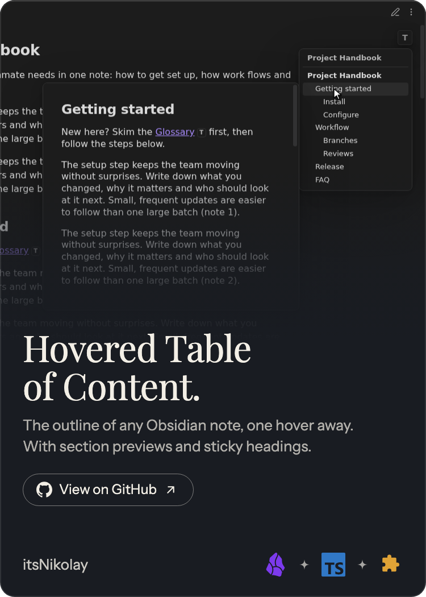
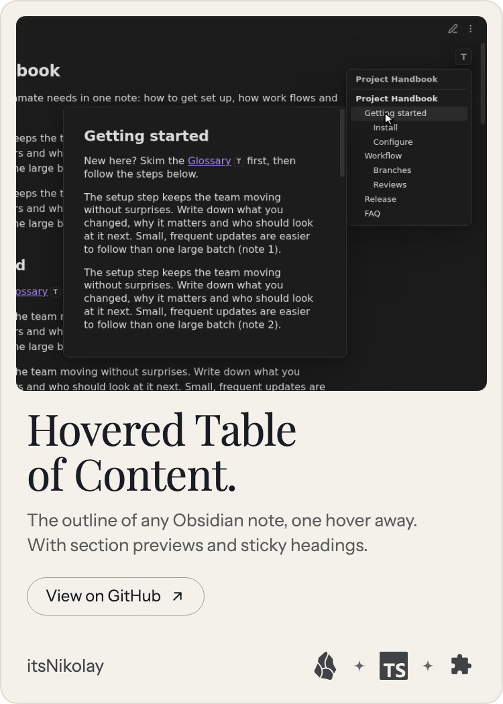

# Card signature

A project card is a poster for a GitHub profile README: a picture at the top that fades into the card,
a serif headline, one or two lines on what the project gives the user, a pill button and a row of icons.
It comes in two themes: the dark `card.png` and the light `card-light.png`. The README snippet shows the
light one on GitHub's light theme through `<picture>`, and the dark one everywhere else.

 

## ProjectCard

Each project has one `cards/<slug>/card.json`. Its shape is the `ProjectCard` type in
[`src/card.ts`](src/card.ts) and the JSON Schema in [`schema/card.schema.json`](schema/card.schema.json):

```ts
interface ProjectCard {
  version: 1;
  repository: string; // GitHub owner/name of the project; the card links there
  headline: string;   // project name without a dot, at most 2 lines (~44 chars)
  sub: string;        // what it gives the user, at most 2 lines (~120 chars)
  cta: string;        // pill button, usually "View on GitHub"
  owner: string;      // bottom left, usually the GitHub user
  icons: CardIcon[];  // up to 3, bottom right
  link?: string;      // https:// address the card leads to instead of the repository
  image: {
    x: number;        // 0–100, horizontal focus
    y: number;        // 0–100, vertical focus
    zoom: number;     // 100–220
    height: number;   // 45–72, share of the card the picture covers
  };
}

type CardIcon = 'obsidian' | 'typescript' | 'plugin' | 'javascript' | 'css' | 'markdown'
  | 'react' | 'nodedotjs' | 'python' | 'ruby' | 'rubyonrails' | 'github' | 'googlechrome' | 'go';
```

A card links to its repository on GitHub. A project that is private on GitHub or lives in a store sets
`link` instead, such as its Chrome Web Store page; `repository` still names its source.

Next to `card.json` lie the picture, `art.png` (or `.jpg`, `.webp`), and the rendered `card.png` and
`card-light.png`. An optional `art-light.png` is the picture for the light card; without it the light card
shows `art.png` framed in a rounded panel, since a dark screenshot does not fade well into a light card.

Icon marks come from [simple-icons](https://simpleicons.org) (CC0). To add one, put its name, path and brand colour
into [`src/icons.ts`](src/icons.ts) and its key into the `enum` in the schema; the tests check both agree.
`npm run render` without slugs also writes every icon to `icons/<key>.svg` for the section headings of the
profile README, in its brand colour; a black brand follows the reader's colour scheme.

## Design

| | |
| --- | --- |
| Canvas | 750 × 1050 PNG (5:7), transparent corners, shown at `width="250"` |
| Background | Dark `#191c22` with text `#f3efe6`; light `#f4f1ea` with text `#191c22`; subtitle at 70 % and footer at 82 % opacity |
| Edge | 2 px inner ring in the text colour at 10 %, radius 26 px |
| Picture | Full width, top 57 % by default (750 × 598 lands 1:1), fades into the background from its middle; framed: 24 px in, radius 14 px, no fade |
| Headline | Playfair Display 400, 64 px, line height 1.06, balanced, at most 2 lines |
| Subtitle | Instrument Sans 400, 26 px, line height 1.4, at most 2 lines |
| Button | Instrument Sans 24 px in a 1.5 px outline pill, the mark of the site it leads to in front (GitHub or Chrome Web Store, none for others) and a ↗ arrow after |
| Footer | Owner on the left; icons at 42 px in their brand colours (black brands in the text colour), separated by ✦ sparks on the right, 36 px from the bottom |

`npm run render` refuses a card whose headline or sub runs past 2 lines or whose text runs into the footer.

## Writing the copy

- **headline**: the project name, without a trailing dot: `Hovered Table of Content`.
- **sub**: one or two plain sentences about what the user gets, not how it is built.
- **cta**: what the button does, usually `View on GitHub`; `Add to Chrome` for a Chrome Web Store link.
- **icons**: platform first, then language, then kind of project.
- **image**: a screenshot or illustration with its subject in the middle, about 750 × 600 px.
  A dark picture blends best; start from `{ "x": 50, "y": 50, "zoom": 100, "height": 57 }`.

## Asking Claude for a card

> Make a ProjectCard `card.json` for the GitHub repository OWNER/NAME, following SIGNATURE.md and
> schema/card.schema.json in itsNikolay/itsNikolay. Read the repository's README and package metadata.
> The headline is the project name without a dot; the sub is one or two plain sentences on what it gives
> the user, at most 120 characters; the cta is "View on GitHub"; the owner is OWNER; pick up to 3 icons
> from the schema. Start the image at { "x": 50, "y": 50, "zoom": 100, "height": 57 }. Answer with the JSON only.

## Header

The profile header, `header/header.json`, is set in the same type on a transparent background, flush left
like the rest of the page: the name in Playfair Display, a tagline and up to four technologies in small
capitals. `npm run render` without slugs renders it to `header/header.png` and `header-light.png`, 1530 × 390,
shown at `width="510"`, the width of two cards side by side. A technology named like an icon in `src/icons.ts`
gets that icon in front, in its brand colour.

```json
{ "name": "Nikolay Ponomarev", "tagline": "Better than yesterday.", "stack": ["Ruby on Rails", "TypeScript", "Go", "Obsidian"] }
```
